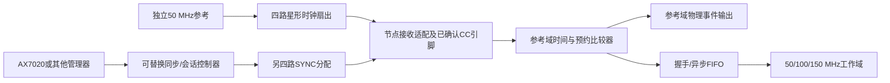

# 完整架构比较

日期：2026-11-01。统一比较条件：50 MHz参考、4个预留节点、50/100/150/50 MHz业务时钟；同一局部系统的桌面/机箱布线。精度未获用户正式指标。输出边沿偏差、逻辑时间offset、吞吐和处理延迟分别比较，不混用一个数字。

| 维度 | A：AX7020参考主节点+缓冲 | B：独立参考分配+可选AX管理 | C：独立XO+协议/逻辑时间校正 |
|---|---|---|---|
| 基本组成 | AX50 MHz → 专用转发输出 → 扇出/线缆 → 节点；独立SYNC/控制 | 振荡器 → 四路星形时钟；另一组四路SYNC；节点适配；独立SYNC控制源 | 每板本地XO、硬件时间戳、双向链路、频偏估计/伺服、预约事件 |
| 同步精度潜力 | 与B接近，但输出路径和AX重配置需要校准 | 最容易控制拓扑/电平/延迟；ns级是待测目标，非承诺 | 逻辑offset可校正；物理时钟相位仍自由，严格边沿同步需额外机制 |
| 长期相对漂移 | 共源频率避免独立ppm累积；保留偏斜/温漂 | 同A；绝对UTC准确性仍由XO决定 | 无伺服时±50ppm两板一天相差8.64s；伺服取决于timestamp和不对称 |
| 外部硬件 | 4路星形仍建议扇出；不能把一根GPIO直接T接四板 | 振荡器、时钟及SYNC驱动、4接收适配、电源/连接器 | 减少专用clock线；现有网口是否支持所需硬件timestamp仍待查，精密路线可能反而更贵 |
| 电气安全 | 须审J10/J11串阻、输出驱动、线缆、独立供电 | 专用板更便于阻抗与电平控制，但当前尚无电气设计验收 | 网络隔离便利；不能因此推断接收时钟与PS安全 |
| FPGA资源 | AX主输出/管理+每节点core/MMCM/FIFO | 每节点同A；独立SYNC生成器/管理器另计 | MAC/协议/时间戳/伺服等，未综合，不给伪资源数字 |
| 时钟域 | 各板仍为独立实现的clock域；CDC必需 | 同A；可保留板载XO作独立失源监测 | 多个独立域和调整后的逻辑时间；CDC和单调性更复杂 |
| 吞吐 | 数据链路另外设计，与reference扇出无直接等价 | 同A，可按source-synchronous/packet链路预算 | 带宽、排队和同步消息竞争；需QoS与硬件timestamp |
| 扩展与未用口 | AX IO与扇出数量限制；软件mask | 固定四clock+四SYNC分支；1–4启用；空口依器件规则处理 | 协议节点数易扩展，但本地精密边沿难度不变 |
| 故障/恢复 | AX断电/重配置影响全体；全部失效会话再同步 | reference单点故障仍存在；AX管理离线可保持已预约运行 | 失联holdover，漂移预算到期禁止同步事件；新会话/重同步 |
| AX依赖 | 必须 | 可选；**独立板必须有替代SYNC/配置源，只有XO+扇出并不完整** | 可选管理；peer/master仍须指定 |
| 成本/难度 | 两节点验证可能最快；四节点缓冲/适配不一定更便宜 | 预计整体原型材料人民币300–1000，工程估算，见BOM | 简单逻辑同步便宜；高精度PTP/WR和仪器可能显著增费 |
| 本轮证据 | 共享参考逻辑/器件输出资源可用；未实现完整AX主控制器 | 数字核心/时钟原语/管脚路线可行；PCB与物理校准待做 | 数学/算法模型可行；未实现完整PTP或WR RTL栈 |

**推荐 B 作为四节点长期目标；若获后续试验授权，先借 A 的缓冲后两节点台架降低首次验证成本。** 这是一条有条件的开发路径，不是声称 B 在任何精度/距离/预算下必然最优。若用户仅需微秒级逻辑协调、现有网络满足timestamp要求，C可以重新成为优选。若用户要求真实亚纳秒长期相位一致，当前资料和仪器不足以冻结任何方案。

四节点数据流水线是业务拓扑，星形参考是时钟拓扑，二者不必一致。节点数是1–4的参数/使能mask；改变有效数不重写同步RTL。业务流水线的阶段重映射与断链绕行尚未实现，不能把同步节点数支持等同于任意节点删去后四级任务自动继续。
