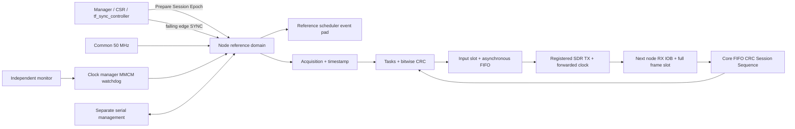

# TIMEFOOT v1 系统架构

Stage: INTERFACE_TIMING_CLOSURE_AND_PRE_PCB_READINESS。用户批准来源：`AI-interaction-memory/cross-agent/TIMEFOOT_v1_PRE_PCB_USER_INSTRUCTION.md`。实现源 Commit 和最终验证见本目录 VALIDATION_AND_REPRODUCTION.md；本文不代表实板验收。

## 组成与闭环

保持 B 架构：一个独立公共50MHz源，四路CLOCK和四路SYNC，节点可独立加入；各节点从公共参考通过MMCM产生业务时钟。默认四槽业务频率50/100/150/50MHz。独立monitor时钟检测公共参考失效，不能用被监测的参考本身作为唯一失效检测时钟。AX7020是可选管理节点；数字RTL不依赖PS软件才能模拟业务。

内部208bit帧不改变。`tf_physical_node_top`把数据送入真实4/8bit适配器，将管理、事件、诊断功能映射到串行寄存器和独立参考域输出。`tf_node_top`保留原宽接口用于历史比较与逻辑集成，旧负STA不会被覆盖。

## 源码职责

| 模块 | 职责 / 时钟 |
|---|---|
| tf_sync_controller / tf_control_interface / tf_system_top | 1–4槽管理、显式stage map、Session/Epoch协调；manager参考域 |
| tf_clock_manager | MMCM、monitor心跳/失锁检测、异步断言同步释放复位；心跳相位不因局部reset截短 |
| tf_timebase / tf_event_scheduler | Prepared/Apply、统一64bit时间、预约/取消/实际执行时间和计数；ref域 |
| tf_data_source / tf_task_pipeline | 真正timebase采集时间戳；转换/处理/输出阶段；业务域 |
| tf_stream_tx / tf_crc_engine / tf_stream_link | CRC-32/BZIP2、Session/Sequence/Length和流控；业务/接收域 |
| tf_link_tx / tf_link_clock_forward | 输入保持槽、16深度跨域FIFO、整帧credit、MSB先行、ODDR转发时钟 |
| tf_link_rx | IOB输入、208bit重组保持槽、credit、异常SOF/中止计数；收到的转发时钟域 |
| tf_status_snapshot | XPM完整握手，多位任意跳变的原子快照；不能用Gray编码任意计数跳变 |
| tf_management_serial / tf_node_registers | 独立48bit串行命令、跨域命令/回复FIFO、寄存器访问、原子状态冻结 |

## 配置及恢复边界

节点减少不会自动迁移算法。manager必须在quiescent状态写入合法active_mask和每槽stage map，启动新Session并重新Prepare/Apply。1节点执行全部三阶段，2节点拆分为1+6，3节点1+2+4，4节点采集源+1+2+4；编码以现有CSR/TB为准。未用槽不参与Prepared/Ready汇总。

检测参考失效、未资格化SYNC、CRC/Session/Sequence/帧错误时停止RUN，清除时间有效性，中止队列；重新锁定不直接恢复旧任务。新Session和Epoch通过验证后才允许RUN。外部管脚top的管理控制器必须实际执行该握手，不能把资格输入常置1。

## 不在本阶段内

无PS7启动镜像、bitstream上板、PCB、原理图、线缆实物、电源/IBIS/BER测量。完整FPGA数字STA不等于板级SI或各板电压已确认。详见 OPEN_ISSUES_AND_RISKS.md。
